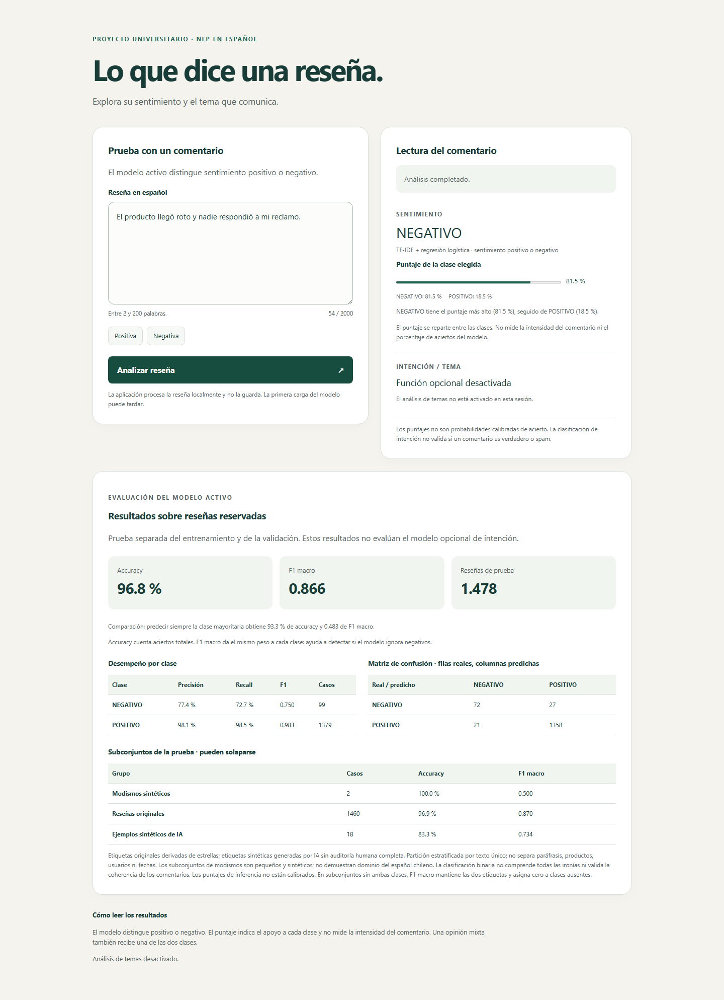

# Análisis de reseñas en español

Proyecto universitario de NLP que clasifica reseñas como **POSITIVAS o NEGATIVAS**. Incluye limpieza de datos, entrenamiento, evaluación y una aplicación web responsiva. El modelo ligero ya entrenado está incluido en `modelo_publicado/`; no necesitas entrenar para probarlo.



## Descargar y ejecutar

Descarga y descomprime el repositorio o clónalo con Git. Conserva `modelo_publicado/`, `templates/` y `static/`. Entorno de referencia: Python 3.13 de 64 bits, CPU Windows.

Desde la carpeta del proyecto, en PowerShell:

```powershell
python -m venv .venv
.\.venv\Scripts\python.exe -m pip install --upgrade pip
.\.venv\Scripts\python.exe -m pip install -r requirements.txt
.\.venv\Scripts\python.exe app.py
```

Abre [http://127.0.0.1:5000](http://127.0.0.1:5000). `probar.py` también inicia la aplicación. Si el puerto está ocupado, usa `app.py --puerto 5001`. Después de actualizar archivos o pesos, detén el servidor con Ctrl+C y vuelve a iniciarlo.

En Linux/macOS usa `python3 -m venv .venv` y sustituye `.\.venv\Scripts\python.exe` por `.venv/bin/python`. Las verificaciones locales se realizaron en Windows.

## Modelo listo para usar

El sentimiento utiliza TF-IDF de palabras, caracteres y negaciones con regresión logística y pesos de clase. Se normalizan las tildes para compartir evidencia entre variantes de escritura. Funciona localmente sin TensorFlow, GPU, conexión a Internet ni descargas de modelos.

Sube **toda la carpeta `modelo_publicado/` a GitHub**:

- `clasificador.joblib`: vectorizadores y clasificador entrenados.
- `modelo.json`: clases, motor y SHA-256 de los pesos.
- `evaluacion.json`: resultados, versiones, fuentes y configuración.
- `particiones.json`: huellas de textos y etiquetas de cada partición, sin los comentarios completos.

Los archivos `.joblib` son artefactos de Python: cárgalos solo de una fuente de confianza. La huella comprueba integridad, no la confianza en el autor.

El resultado muestra los puntajes de **dos clases**. Se elige el mayor; el porcentaje no mide intensidad emocional ni porcentaje de aciertos y no está calibrado como probabilidad de acertar. Una opinión mixta también recibe positivo o negativo. La aplicación no predice estrellas ni ofrece detección de sarcasmo.

Para activar opcionalmente el análisis de intención o tema:

```powershell
.\.venv\Scripts\python.exe -m pip install -r requirements-opcionales.txt
.\.venv\Scripts\python.exe app.py --contexto
```

Esta función utiliza el modelo externo [Recognai](https://huggingface.co/Recognai/bert-base-spanish-wwm-cased-xnli), necesita PyTorch y descarga pesos la primera vez. Después reutiliza la caché local. Sus resultados no forman parte de las métricas del clasificador de sentimiento. La aplicación no guarda los textos ingresados y escucha solo en `127.0.0.1` para demostración local.

## Datos y resultados

Se conservaron los CSV originales. El entrenamiento binario excluye las filas marcadas `requiere_revision=true`, las etiquetadas como neutrales o de 3 estrellas y las marcadas `sarcasmo=si` o `ambiguo`. Esta exclusión solo utiliza etiquetas existentes; no detecta ironías no etiquetadas.

El conjunto principal contiene 9.851 textos únicos: 9.191 positivos y 660 negativos. Se combinaron 9.724 reseñas originales limpias y 127 ejemplos sintéticos admitidos del CSV aportado. Sobre las 10.474 filas de entrada se excluyeron primero 32 pendientes de revisión, 71 marcadas como sarcasmo y 520 neutrales restantes. Las categorías de exclusión se cuentan en ese orden, sin duplicar filas.

Se añadieron **120 ejemplos sintéticos complementarios**, 60 por clase, en `datos/ampliacion_entrenamiento.csv`, sobre daños, entregas, atención, devoluciones y negaciones. Solo se añaden a entrenamiento, después de separar el conjunto principal. Se excluye cualquier coincidencia con los textos de todas sus particiones. No se presentan como reseñas reales o etiquetas humanas. El modelo se ajusta con un total de 9.971 textos entre todas las particiones: 9.251 positivos y 720 negativos.

Las etiquetas originales se derivan de estrellas; las del CSV sintético son de IA y no tienen una auditoría humana completa. Solo `Comentario` se usa como entrada: justificaciones, valoraciones y otras etiquetas no se entregan al modelo como características.

Particiones finales: **7.015 entrenamiento, 1.478 validación y 1.478 prueba**. Vocabulario e IDF se ajustan solo con entrenamiento. El reparto principal se estratifica por clase y origen cuando hay suficientes ejemplos, con semilla 42. La regularización y el peso de los ejemplos complementarios se eligen por F1 macro de validación entre seis configuraciones; la elección no consulta la partición de prueba. La configuración elegida es `C=8` y peso complementario `1`. El informe guarda todos los candidatos.

| Métrica de prueba | Modelo incluido | Siempre positivo |
| --- | ---: | ---: |
| Accuracy | 96,8 % | 93,3 % |
| F1 macro | 0,866 | 0,483 |

| Clase | Precisión | Recall | F1 | Casos |
| --- | ---: | ---: | ---: | ---: |
| NEGATIVO | 77,4 % | 72,7 % | 0,750 | 99 |
| POSITIVO | 98,1 % | 98,5 % | 0,983 | 1.379 |

El panel muestra estos valores, matriz de confusión y subconjuntos por origen y modismos. Accuracy puede parecer alta porque predominan los positivos; F1 macro da el mismo peso a ambas clases. **Estas métricas son de una tarea binaria y no se comparan directamente con las del modelo anterior de tres clases**, cuyo conjunto de prueba era diferente. Tampoco evalúan el BETO original.

## Entrenar tu propio modelo

Prepara un CSV UTF-8 con `Comentario` y al menos una de las columnas `sentimiento` o `Estrellas`:

```csv
Comentario,Estrellas,sentimiento,requiere_revision,origen
"Excelente producto y buena entrega",5,positivo,false,propio
"Llegó roto y nadie respondió",1,negativo,false,propio
```

Sin sentimiento explícito, 1 a 2 estrellas se interpreta como negativo y 4 a 5 como positivo. Las filas de 3 estrellas o sentimiento neutral se excluyen. Las contradicciones entre etiquetas se descartan. Se necesitan al menos 10 textos únicos positivos y 10 negativos; ese mínimo técnico no garantiza calidad.

```powershell
.\.venv\Scripts\python.exe entrenar.py --datos mis_resenas.csv --salida modelos/mi-modelo
.\.venv\Scripts\python.exe app.py --modelo modelos/mi-modelo
```

Puedes pasar varios CSV después de `--datos`. El entrenador limpia y deduplica, separa entrenamiento/validación/prueba, añade los ejemplos complementarios solo a entrenamiento y guarda pesos, métricas y particiones. Para usar otro complemento pasa `--ampliacion otro_archivo.csv`; para entrenar únicamente con tus archivos añade `--sin-ampliacion`. La salida debe ser una carpeta nueva o vacía para conservar los modelos anteriores.

Para probar el proceso únicamente con el CSV sintético incluido:

```powershell
.\.venv\Scripts\python.exe entrenar.py --datos dataset_resenas_completo_300.csv --salida modelos/demo
```

Ese modelo usará menos datos y tendrá métricas propias. Para reproducir el modelo publicado necesitas el mismo CSV original limpio, que se conserva localmente pero no se redistribuye hasta documentar su procedencia y permisos:

```powershell
.\.venv\Scripts\python.exe entrenar.py --datos reviews_limpio.csv dataset_resenas_completo_300.csv --salida modelos/reproduccion --semilla 42
```

## BETO original y entrenamiento con BETO

El [BETO](https://huggingface.co/dccuchile/bert-base-spanish-wwm-uncased) binario original sigue disponible localmente, sin modificar sus pesos. Para utilizarlo instala las dependencias adicionales y conserva su carpeta con `config.json`, `tf_model.h5` y los archivos de tokenización:

```powershell
.\.venv\Scripts\python.exe -m pip install -r requirements-beto.txt
.\.venv\Scripts\python.exe app.py --modelo mi_modelo_guardado
```

Esos pesos de unos 440 MB no se incluyen en GitHub. No tienen un informe independiente de prueba verificable y no se les atribuyen las métricas del modelo ligero.

Para entrenar un nuevo BETO binario:

```powershell
.\.venv\Scripts\python.exe entrenar.py --motor beto --datos mis_resenas.csv --salida modelos/beto-binario --epocas 2 --batch 8
.\.venv\Scripts\python.exe app.py --modelo modelos/beto-binario
```

El orden es `0=NEGATIVO, 1=POSITIVO`, guardado en `config.json`. Se usan pesos de clase y parada temprana con validación. La primera ejecución descarga el modelo base; entrenar en CPU puede tardar bastante. Reduce el lote si falta memoria. Se puede usar una carpeta local con `--base mi_modelo_guardado`. TensorFlow utiliza `tf-keras` y Transformers 4.57.3 para mantener compatibilidad con el formato original. Los modelos de tres clases deben volver a entrenarse para esta versión binaria.

## Evaluar con datos nuevos y ejecutar pruebas

```powershell
.\.venv\Scripts\python.exe evaluar.py --modelo modelo_publicado --datos evaluacion_humana.csv --salida evaluacion_externa_humana.json
.\.venv\Scripts\python.exe -m pip install -r requirements-test.txt
.\.venv\Scripts\python.exe -m unittest discover -s tests -v
```

La evaluación externa excluye textos que coincidan exactamente con cualquiera de las particiones conocidas y aplica el mismo filtro de etiquetas. Si faltan las particiones, informa que no pudo comprobar independencia. Las 22 pruebas automatizadas comprueban limpieza, exclusiones, entrenamiento, exportación, recarga, API, separación de particiones y regresiones del modelo publicado. GitHub Actions las ejecuta en cada push y pull request.

Los casos de regresión son ejemplos de desarrollo para proteger errores conocidos; no sustituyen una evaluación independiente. Ninguno de los nueve textos de regresión se copió literalmente al entrenamiento, aunque hay ejemplos relacionados. Persisten errores en frases sobre reclamos resueltos y ausencia de problemas, documentados en [Casos de desarrollo](docs/CASOS_DESARROLLO.md).

API: `POST /api/analizar` con `{"texto":"Excelente producto"}`, `GET /api/estado` y `GET /api/metricas`. El informe corresponde a los pesos del modelo seleccionado.

## Publicación y límites

Publica código, README, dependencias, pruebas, ejemplos sintéticos y `modelo_publicado/`. `.gitignore` excluye `datos.csv`, `reviews_limpio.csv`, el BETO pesado, `modelos/`, entornos y respaldos `originales/`.

La deduplicación no separa paráfrasis, productos, usuarios o fechas. El modelo puede equivocarse ante ironías, opiniones mixtas o cambios de dominio. El CSV sintético no reemplaza una evaluación externa revisada por personas. Retirar clases cambia la tarea; no demuestra una mejora de comprensión del lenguaje.

El scraper, las fuentes y las fechas de recopilación originales no estaban disponibles. Los autores deben documentar la licencia del trabajo y los permisos de redistribución de los datos. No se ha asignado una licencia unilateralmente. Los modelos externos tienen sus propias condiciones.
